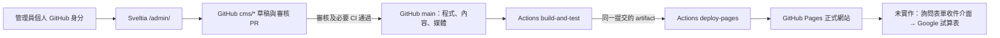

# BXR 官網唯一架構規範

本文件是 Codex、Claude 與工程師接手時的唯一正式架構依據。日期：2026-10-30（台北）。架構變更須經公司確認；歷史 EmDash／Cloudflare 文件及實驗不代表正式架構。

本版本的程式修正須經 PR 合併與發布後才會影響線上網站。真人 GitHub 登入、editorial workflow、Actions 與 Pages 端到端狀態，依本次驗收報告標示，不因本機測試通過而視為已驗收。

## 1. 唯一責任系統

| 功能 | 正式負責系統 | 規則 |
| --- | --- | --- |
| 網站框架 | Astro | 公開產物是靜態 HTML／CSS／JS，不依賴長期運作的 CMS 伺服器 |
| 程式、內容、原始媒體版本 | GitHub Repository | `main` 是唯一正式版本；不從遠端 CMS 覆寫 |
| 內容管理 | Sveltia CMS | `/admin/` 靜態 App，GitHub backend 指向 `main` |
| 圖片／媒體管理 | Sveltia＋GitHub | 本地資產匯入與共用媒體 registry；原檔保持不變 |
| 建置、驗證、發布 | GitHub Actions | `.github/workflows/ci.yml` 同一版本驗證後發布，不另開第二部署 |
| 正式託管 | GitHub Pages | `https://magician-eric.github.io/bigxreality-web/` |
| 詢問收件 | 尚未實作 | 現有聯絡頁是 mailto。Google 試算表收件另案處理 |

Sveltia 自身固定版本的 CDN、GitHub API，以及已核准的外部影片來源不是第二套 CMS。不得擅自新增 EmDash、Strapi、PHP CMS、Cloudflare 部署、D1／R2 內容來源或新的長期 Node CMS 服務。

## 2. Git 與內容來源

- `main`：正式程式、文案與媒體的唯一可發布版本。
- 開發分支：送 PR 到 `main`，不直接合併正式站。
- `cms/*`：Sveltia editorial workflow 的待審內容版本。
- `feature/sveltia-cms`：歷史整合分支，保留資料與 Git 歷史，不再作 CMS 正式讀寫目標，也不直接覆蓋或重設它。
- 正式建置明確使用 `BXR_CONTENT_SOURCE=markdown`、`BXR_PREVIEW=0`；Pages packager 拒絕 EmDash／bootstrap／fixtures／preview 及 Workers CI 產物。
- 測試 fixture 只存在 `tests/fixtures/` 與 `dist-fixtures/`；它不是第二套正式內容來源，不能上傳為 Pages artifact。

本次已完成 main 與歷史分支比對，見 [同步診斷](audits/cms-sync-2026-10-30/SYNC-DIAGNOSIS.md)。若在切換期間出現新 feature-only 提交、cms 草稿或未儲存表單，先保存兩版並逐檔核對，禁止以任一整個分支覆蓋另一個分支。

## 3. 文章、三語及資料位置

- 內容：`src/content/<collection>/<tw|en|jp>/<slug>.md`。
- Astro schema：`src/content.config.ts`；Sveltia 欄位由 `scripts/sveltia/generate.mjs` 依 schema 產生，不能只手改 config.yml。
- TW 是日期、草稿、分類、排序及關聯等結構欄位的來源；EN／JP 不是另一套結構資料庫。
- 三語共用相同 slug、ARTICLE_ID、mediaId 及媒體。既有 URL 不重命名；案例 collection `case-studies` 的 URL 維持 `/cases/`。
- 已知日期維持原值；未知日期保持空值，不填今天或 1970。
- 新聞／產品／解決方案／案例等可由 CMS 編輯；固定頁只開放既有檔案，不能刪除頁面結構。
- `src/content/ui/*.json`、`src/data/home.ts`、`src/data/technologies-*.ts`、`src/data/site.json` 等程式資料仍在同一 Git main 管理。尚未提供 CMS 編輯入口的資料，不能假稱固定頁欄位可控制它；實際編輯範圍見 [CMS 欄位對照](CMS-FIELD-MAP.md)。擴充後台範圍必須等值遷移與另行驗收，不任意搬家、改文案或重做元件。

## 4. 媒體

- 產品／解決方案：`src/assets/images/products/`。
- 新聞照片：`src/assets/images/news/`；多圖集／影片：`src/data/news-media.json`。
- 客戶 Logo：`src/assets/images/clients/`，配合共用分類資料。
- 一般內容：`src/assets/images/content/`（有實際上傳時使用）。
- 本地新聞影片：`public/media/news/`；首頁影片：`public/video/hero/`。
- 原始製作來源、設計規範與媒體清單保留；它們不是另一個線上媒體庫。
- 優先使用 Astro 支援的本地 image 匯入，不把 `src/assets` 當作 public URL。
- 明確的文章 cover／hero 優先；共用 registry 或既有映射提供對應 fallback。沒有素材時不使用其他文章照片。
- 新上傳檔案使用新檔名；CMS 的媒體檢查拒絕覆蓋／刪除既有來源檔。文章刪除不連帶刪除照片或影片。
- 三語 alt 與必要核准欄位完整後才顯示；外部影片沿用合法嵌入或一般連結，不自行下載。

## 5. CMS 登入、草稿與發布

1. 每人使用自己的 GitHub 帳號與限倉庫 PAT，不共用最高權限 Token。設定為 Contents／Pull requests read+write；不放進 repository 或公開環境變數。
2. 現行只設定 token 登入，沒有部署 OAuth broker、第二 CMS 帳號系統或站內認證資料庫。登入／審查權限由 GitHub 管理；Sveltia 沒有可取代 GitHub 的伺服器端 RBAC。
3. Repository 管理者須核對 main 的 PR／review／必要 CI 規則；本機 config 不能證明遠端分支保護已設定。
4. Save Draft 儲存至 CMS 審核分支，**不等於更新 main，也不等於官網已公開**。
5. Publish 目標是 main；GitHub 若要求審核或 CI，須先完成，不能繞過保護。main 更新後才觸發正式建置。
6. TW frontmatter `draft` 是前台公開開關，與 CMS workflow 草稿狀態不同。即使 Publish 合併成功，draft=true、未到日期、核准不足或翻譯未完成，仍可能不公開。
7. main CI 全部通過，才部署同一次建置的 Pages artifact。CI 失敗時保留前一個已成功部署版本。
8. 更新本修正後，先保存尚未儲存內容，登出並刷新後台，確認線上 config 的 backend.branch 是 main。不要直接將舊編輯表單內容覆蓋新版 main。

### 新增產品／解決方案／新聞

- 建立英小寫、連字號 slug，三語檔名一致；新聞 ARTICLE_ID 保持唯一。
- TW 先維持 draft=true，保存三語草稿。可先將未公開的三語檔分次經 PR 合併，避免尚未齊備時公開。
- 完成 EN／JP，將 translationStatus 設為 translated；三語皆已保存且核准後，再取消 TW 的 draft，經審核 Publish。
- 上傳照片到對應 Git 資料夾，核對實際 src／alt／mediaId；不覆蓋原始素材。
- CI 會檢查 schema、三語完整度、關聯、媒體、SEO 與頁面。新增失敗時看該提交的 Actions，不以重新輸入舊內容硬蓋新版解決。

### 修改、下架與刪除

- 修改只動管理員選擇的欄位；既有 slug、日期與其餘語言不自動重寫。
- 建議先以 TW draft=true 下架，再刪除三語內容檔；固定頁維持禁止刪除。
- CMS 的文章刪除同樣經 Git 審核／CI，不刪 Git 歷史、原始新聞 TXT 或媒體。若仍被其他頁面引用，須先處理關聯，不能讓壞連結部署上線。
- 刪除已公開 URL 須由審查者確認影響；需要轉址時使用精確對應，不把全部舊網址導向首頁。

## 6. 建置與 Pages 發布

- 唯一正式 workflow：`.github/workflows/ci.yml`。
- PR：執行 build-and-test 與 Pages artifact 檢查，不部署。
- main push／對 main 的手動 workflow：檢查成功後上傳 `dist-pages/`，deploy-pages 以同一 workflow 的 artifact 部署；不是另外再從另一分支建置。
- Node 版本來自 `.node-version`（22 系列）；本機需支援原生 TypeScript 腳本，建議至少 22.18 並與 CI 同版。
- `npm ci`；`npm run pages:build` 會從 Git 內容建置、封裝與驗證。一般 `npm run build` 的中間輸出目前仍是 `dist/client/`。
- `scripts/pages/package.mjs` 是目前唯一專案子路徑封裝入口。不得同時再加一套會重複 prefix 的 URL 改寫流程。
- 正式網址單一來源：`src/data/site.json` 的 url。`public-url.ts` 統一 canonical、hreflang、Schema、sitemap 的絕對 URL；原有 slug／相對路由不改。
- `/admin/`、待翻譯與應排除的頁面保留 noindex；正式公開內容不再全站 noindex。測試資料不得出現在正式 artifact。

### 版本與失敗追查

- `.../build-info.json` 記錄 commit、contentDigest、CMS branch、來源、建置時間與 Actions run URL。
- 此檔代表**該份 artifact**，不保證任意最新 main 都已部署。比較 CMS Publish 進 main 的提交與最新成功部署的 build-info。
- main 尚未變：看 CMS draft／PR 的目標及審核狀態。
- main 已變、站點仍舊：看 Actions build-and-test、deploy-pages、environment approval 與 Pages deployment。
- 同一 SHA 但文字不符：核對實際欄位來源、TW 結構欄位、draft／日期／翻譯，以及瀏覽器是否仍快取舊 config。
- 不以 force push、整分支覆蓋或關閉必要 CI 解決發布失敗。

## 7. 環境變數與憑證

正式 workflow 明確設定：`BXR_CONTENT_SOURCE=markdown`、`BXR_PREVIEW=0`。保留隔離測試用 fixtures profile、`QA_DIST`、`CHROMIUM_PATH` 等測試設定，不當作第二正式來源。

GitHub Actions 由平台提供 GITHUB_SHA／REF／RUN_ID／TOKEN；deploy job 只需要 Pages write 與 id-token write，build job contents read。個人 CMS PAT 只用於管理員自己的受信任瀏覽器。

`EMDASH_URL`、`EMDASH_TOKEN`、`CF_ACCESS_CLIENT_ID/SECRET`、`DEPLOY_HOOK_URL`、`EMDASH_ENCRYPTION_KEY`、`WORKERS_CI` 不屬於正式 Pages 流程需求；待舊架構確認、備份與停用後移除相應舊設定，不把值貼進文件。

## 8. 尚待清理的歷史耦合

Astro config 仍有 Cloudflare adapter／EmDash integration，與部分舊腳本、型別、依賴。它們是待移除的**建置耦合**，不是正式 CMS／託管平台；Pages 只發布 client 靜態產物，不上傳 server／Worker。

本次先修正同步並驗收，不假稱已完成卸載。詳 [舊架構安全移除計畫](LEGACY-REMOVAL-PLAN.md)。未驗證外部內容與備份前，不刪 Worker、D1 或 R2；不因檔案存在就認定服務正在使用，也不因 Pages 未用到就推論外部資源沒有資料。

## 9. 開發與驗收規範

- 以最新 main 建立獨立分支，先診斷與保留差異，再修改；PR 直接對 main，不自行合併。
- 不新增第二 CMS、遠端內容優先覆寫、重複正式部署或未核准後端。
- 不任意改 URL、原始圖片、歷史新聞事實、三語對應或既有正常元件。
- 驗證 build／TypeScript、schema／三語、產品／解決方案／新聞／資源頁、媒體、SEO／canonical／hreflang／sitemap、桌面／手機。
- 用隔離副本驗證新增／修改／上傳／刪除，不修改正式文章測試。真人登入、GitHub 審核合併、Actions、線上 Pages 未實測時一律標記尚未驗證。
- 任何卸載必須先拆呼叫鏈、通過 Git-only build，再重建 lock；不能只刪套件。回復以 Git revert 與已備份的外部設定／資料為依據；Git revert 不能復原已刪資料庫。

## 10. 客戶詢問：開發中的 GAS 可行性驗證

已授權的評估方向為 Astro 共用三語表單 → Google Apps Script → Google Sheets；不用 Google Forms 原生介面、Workers／D1／R2、第二 CMS 或長期 Node 後端。

目前只建立隔離 POC，Google Web App 尚未部署、跨來源成功／失敗回應及實際 Sheet 寫入尚未驗證，正式聯絡頁仍為 Email。先依 [GAS POC 設定](inquiry/GAS-POC-SETUP.md) 完成 Pages-origin 端到端驗證，再開發正式表單。不得用 no-cors 不透明回應或 iframe load 事件表示成功；直接串接不成立時先提同一 GAS 的最小替代方案供確認，不自行加新服務。
